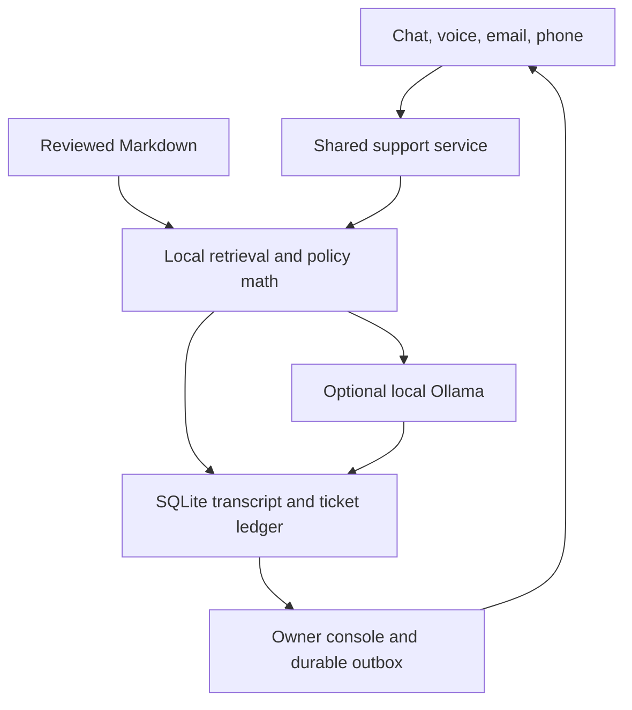

# Auto Customer Support

**A local-first support desk for a small business.** Give it reviewed Markdown policies, embed the chat widget, and keep conversations, unanswered questions, owner replies, and delivery status in one place.

**Status: MVP / prototype, v0.1.0.** One business and one server process per installation. The source is reusable; each business supplies its own local configuration and knowledge.

## Included

| Capability | Implemented behavior |
|---|---|
| Knowledge | Drop or upload Markdown, automatically sort by category, review and approve, retrieve locally, cite sources, expire and revoke policies. |
| Website chat | Embeddable launcher/widget, private conversation tokens, history, contact collection, and owner-reply polling. |
| Local AI | Ollama answers from approved sources. If unavailable, quote relevant approved text or escalate. No model API key required. |
| Shipping estimates | Deterministic calendar/business-day dispatch calculations. Keeps processing, delivery, and verified order status separate. |
| Human handoff | Persistent tickets with reason, contact details, full transcript, deadline, owner notification drafts, and overdue reminders. |
| Owner resolution | Reply in the console; customer sees the answer in chat and can receive it through the email outbox. |
| Email | TLS IMAP intake, deduplication, sender-scoped threading, loop suppression, and durable SMTP delivery. Draft-only by default; automatic replies are opt-in. |
| Browser voice | Optional local faster-whisper transcription and local Kokoro-compatible speech generation. Push-to-talk. |
| Telephone | Optional signed Twilio Gather/Say adapter: cloud speech around the local support engine. Requires a number and public HTTPS callback. |
| Connector extension | Read-only JSON/HTTP order connectors requiring a trusted identity integration before customer use. |
| Operations | Authenticated console, local SQLite, audit records, bounded inputs, pinned runtime dependencies, backup CLI, tests, and Docker packaging. |

This repository contains **fictional example policies only**. Actual business knowledge, transcripts, orders, audio, and credentials stay in ignored local directories.

## Start locally

Python 3.11+ is required. Core behavior has been exercised on Linux/Python 3.12; voice acceleration needs platform-specific setup.

```sh
git clone https://github.com/goosnav/auto-customer-support.git
cd auto-customer-support
python3 -m venv .venv
source .venv/bin/activate
pip install -r requirements.lock
pip install -e . --no-deps
support-desk init --demo
support-desk serve
```

On Windows, activate with `.venv\Scripts\activate` and use your installed Python launcher.

Open **http://127.0.0.1:8000**. Copy `ADMIN_TOKEN` from the generated local `.env` into the login form. Each installation gets a random token; there is no shared default password. Set `BUSINESS_NAME`, `OWNER_EMAIL`, and other settings in `.env`, then restart.

`--demo` stages sample policies for review; it does **not** approve them. Open **Knowledge**, read the documents, and approve the examples you want to test. Archive or remove them before installing real policies. Use `support-desk init` without `--demo` for an empty installation.

The app works without a language model in conservative knowledge-only mode. For local generation, install [Ollama](https://ollama.com/download), keep it running, and download a model:

```sh
ollama pull qwen3:8b
```

Defaults: `OLLAMA_URL=http://127.0.0.1:11434`, `OLLAMA_MODEL=qwen3:8b`. The model is configurable; quality and latency depend on the hardware and question set. The console checks whether the selected model is present. Set `OLLAMA_MODEL=` for deliberate extractive-only operation.

### Test the requested workflow

1. Approve the fictional **8–12 calendar day** dispatch policy.
2. In **Test desk**, ask: `I ordered 4 days ago. When will it ship?`
3. The answer estimates **4–8 calendar days until dispatch**, cites the policy, and states that the individual order has not been checked.
4. Ask: `Can a human give me a more accurate answer?`
5. Open the resulting ticket in **Conversations** and enter an owner answer.

The simulator records test conversations and tickets but never queues real outgoing email, including owner replies and reminders. Use **Open customer chat** for the web-channel loop with synthetic customer details. Email delivery remains disabled until configured.

## Bring your knowledge

Copy [the onboarding interview prompt](prompts/onboarding.md) into your preferred chatbot. It asks about products, policies, fulfillment, common questions, escalation, and gaps, then produces individual Markdown files. You can also write them directly.

```text
knowledge/                 # local; ignored by Git
  inbox/                   # newly dropped Markdown
  pending/<category>/      # automatically sorted for review
  approved/<category>/     # approved customer-facing knowledge
  archive/                 # revoked sources
data/                      # local; ignored by Git
  support.sqlite3          # conversations, tickets, outbox, receipts, audit
```

The server scans the inbox every 30 seconds. Console uploads ingest immediately. For offline maintenance, use `support-desk ingest`, `support-desk knowledge`, and `support-desk approve DOCUMENT_ID`. While the server is running, use the console so only one process manages the knowledge manifest.

An uploaded file cannot approve itself, even if its YAML says `status: approved`. Approval is tied to its exact contents. Edits invalidate approval until re-reviewed. Expired, archived, deleted, invalid, or internal documents are excluded from customer retrieval. Archive obsolete policies rather than approve conflicting copies.

```markdown
---
title: Dispatch policy
category: shipping
audience: customer
updated_at: "2026-10-23"
shipping:
  event: dispatch
  min_days: 8
  max_days: 12
  day_type: calendar
---
# Dispatch policy

Orders normally dispatch 8–12 calendar days after ordering.
This is processing time, not carrier transit or an arrival guarantee.
```

These numbers are examples, not recommended promises. Ordinary Markdown works for policy answers; arithmetic requires structured timing. `day_type: business` means Monday–Friday, optionally excluding ISO dates in `holidays`. The calculator does not model cutoffs, regional calendars, per-product timing, or preorder availability. Omit structured timing when those conditions make one uniform rule inaccurate. Use `valid_until` for an actual policy expiry.

Files must be UTF-8, at most 128 KiB each. Categories: `business`, `products`, `shipping`, `returns`, `faq`, `support`. Missing categories are inferred. The current limit is 1,000 documents; retrieval ranks whole documents locally. Large collections need chunking and evaluation before scaling.

Prepare customer-facing policies from a company brain. Do not upload private strategy, customer lists, credentials, or internal notes wholesale. Documents marked `audience: internal` cannot be customer-approved.

## Embed on a website

Run the application on your server with HTTPS, then configure:

```dotenv
PUBLIC_BASE_URL=https://support.your-domain.example
ALLOWED_ORIGINS=https://your-domain.example,https://www.your-domain.example
```

Add this to your site:

```html
<script src="https://support.your-domain.example/widget.js" defer></script>
```

The script creates a launcher and an iframe; it contains no admin token. The widget gets a private conversation token stored for that browser session. Closing the session may lose access to the web thread, so collect email for reliable later follow-up. Typing an email or order number does not prove identity or unlock order data.

The host site's Content Security Policy must permit the support script/frame. Microphone use may require its Permissions Policy to permit the support origin. See [deployment](docs/deployment.md) for HTTPS, routing, backups, and uptime.

## Email, browser voice, telephone

- **[Email setup](docs/email.md):** dedicated mailbox, IMAP, SMTP, draft review, automatic replies, threading, and recovery.
- **[Voice setup](docs/voice.md):** local Whisper/Kokoro, telephone webhook, NVIDIA options, and local/cloud boundaries.

The background worker runs with the server. It ingests files, polls configured email, and queues overdue owner reminders. No external email is sent unless `EMAIL_DELIVERY_ENABLED=true`; automatic sending also requires `EMAIL_AUTO_SEND=true`. Owner-authored email replies require explicit **Send**. Web customers see owner replies on the next poll.

Ticket deadlines are internal reminders, not guaranteed customer response times. SMTP `sent` means accepted by the mail server, not verified inbox placement. Ambiguous delivery is held as `unknown`, without blind retries. Replying by email to an owner notification does not resolve a ticket; use the console.

## Architecture



Application code owns access control, arithmetic, tickets, delivery, and connector permissions. The model proposes answers from a bounded set of sources. It cannot send mail, issue refunds, choose arbitrary tools, or rewrite policy. Evidence checks reduce unsupported output; they do not prove every generated sentence correct. Evaluate against actual customer questions before automatic sending.

[Architecture and connector contracts](docs/architecture.md) describe extension points. Shopify/MCP clients, customer authentication for private orders, SMS/WhatsApp/Slack, and external helpdesks are not integrated. Private-order questions currently go to the owner. No payment or order mutations exist.

## Costs and boundaries

The application is MIT-licensed. Local retrieval, SQLite, Ollama inference, and cached speech models can run without per-call model API fees. Model licenses are separate from this code's license.

Hardware, electricity, connectivity, and mailbox/domain infrastructure still have costs. Public phone numbers and carrier minutes are external services. The Twilio adapter additionally uses hosted speech. Email and phone providers still transport their respective conversations.

Browser voice is push-to-talk. The MVP does not implement full-duplex speech, interruption handling, SIP/PBX, outbound callbacks, or telephony Media Streams. NVIDIA PersonaPlex is a potential future runtime, not an installed backend. The voice guide explains the model/license distinctions.

## Development

```sh
pip install -e '.[dev,phone]'
python -m pytest -q
node --check support_app/static/app.js
node --check support_app/static/widget-ui.js
node --check support_app/static/widget.js
```

Tests cover approval/revocation, policy timing, missing evidence, model failures, ticket lifecycle, cross-customer access, duplicate input, SMTP states, signed phone callbacks, and voice bounds. External services are mocked. They do not establish live inference quality, phone latency, or mailbox delivery. Tests do not download models or contact customers.

Runtime dependencies are pinned in `requirements.lock`; optional voice/phone/test dependencies live in `pyproject.toml`. The UI uses plain HTML/CSS/JavaScript with no build step, external fonts, analytics, or CDN. Docker is an alternative in the deployment guide.

### Next release priorities

1. Business-specific evaluation for grounding, completeness, escalation, and policy applicability.
2. Trusted customer authentication plus read-only store/MCP integration.
3. Streaming phone audio with VAD, interruption, cancellation, and measured latency.
4. Mailbox OAuth, delivery events, external helpdesk adapters, and retention controls.
5. Verified backups, uptime, resource budgets, and hardware deployment tests before public launch.
